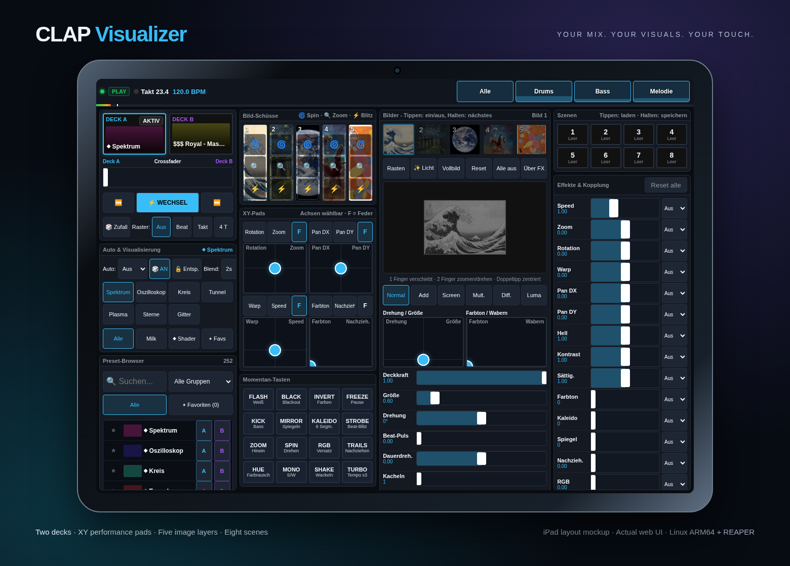

<div align="center">

# CLAP Visualizer

**Your DAW makes the music. Your browser makes the show. Your iPad takes control.**

[](LICENSE)


An audio-reactive VJ playground for REAPER: a lightweight native CLAP effect streams audio and transport to a browser, with a touch controller on your tablet. Built on Linux ARM64 with Omarchy, C++, WebGL2 and Butterchurn.

[**Watch the demo ↗**](https://github.com/goarstne/clap-visualizer/releases/download/v1.0.0/clap-visualizer-demo.mp4) · [**Download & releases**](https://github.com/goarstne/clap-visualizer/releases) · [**Control protocol**](docs/CONTROL.md)



</div>

## What you can do

- **Mix two visual decks:** A/B crossfader, timed transitions, automatic switching and beat/bar quantization driven by host transport.
- **Explore MilkDrop and shaders:** bundled Butterchurn presets plus seven visual types: spectrum, oscilloscope, circle, tunnel, plasma, stars and grid. Search presets, filter groups and save favorites.
- **Perform with touch:** four assignable XY pads, spring return, effect faders and 16 momentary effects, including blackout, invert, kaleidoscope, RGB split, freeze and strobe.
- **Paint with images:** five image layers with drag, pinch, rotation, opacity, six blend modes, tiling, hue, wobble and bass pulse. Trigger zoom, spin and flash shots; draw light with up to three fingers.
- **Tag the wall:** a switch turns the controller into a 16:9 canvas. Draw graffiti tags with your finger; a finished tag is mixed into the visuals and runs through mirror, kaleidoscope, colour and trails. Eight buttons replay, burst, pulse, drip, neon, glitch, rainbow and wipe the tags.
- **Shape the response:** drums, bass and melody selectors with level meters. This is frequency/transient filtering, not AI instrument separation.
- **Recall a look:** eight scene slots, beat-linked effects and visual state saved with the REAPER project. Favorites and pad assignments stay in the browser.
- **Keep audio intact:** stereo float/double passthrough; visualization and networking run outside the audio callback.
- **Run locally:** plugin-served display and controller over HTTP/WebSocket, with bundled browser libraries and no cloud account.

## Setup: Linux ARM64, REAPER and Omarchy

The native plugin is Linux-only and uses an X11/XCB window. On an Omarchy Wayland desktop, REAPER's plugin window needs XWayland. Build on the same architecture as your REAPER installation; an ARM64 `.clap` cannot load in an x86_64 host.

1. Install build dependencies on your Arch/Omarchy system:

   ```bash
   sudo pacman -S --needed base-devel git pkgconf cairo libxcb
   ```

2. Install [REAPER for Linux](https://www.reaper.fm/download.php). For ARM64 choose **Linux aarch64**, extract the archive and run its supplied `install-reaper.sh`. The development machine uses native aarch64 REAPER 7.79. No Windows bridge is needed.

3. Clone, build and install:

   ```bash
   git clone https://github.com/goarstne/clap-visualizer.git
   cd clap-visualizer
   make -j"$(nproc)"
   make install
   ```

   This installs `~/.clap/clapvisualizer.clap` and its adjacent `clapvisualizer.web/` assets. Override the destination with `make install CLAP_DIR=/your/clap/path`. Keep the web directory beside the plugin.

4. In REAPER, rescan the CLAP path in **Preferences → Plug-ins → CLAP** if needed, then add **CLAP Visualizer** to the master FX chain (or a stereo track). Use one instance per port. Play your project so REAPER processes the effect and supplies its transport.

5. Click the **Display** link in the plugin window, or open `http://localhost:8765/` in a WebGL2-capable browser on your computer. Use fullscreen on a second monitor or projector. On the iPad, join the same LAN and open `http://YOUR-COMPUTER-IP:8765/remote.html` in Safari. The plugin window lists LAN addresses. Landscape is the main performance layout; portrait uses two columns.

The iPad controls the browser display; it does not load the native plugin. The mockup above shows the actual interface in an iPad-sized Chromium viewport inside an illustrated tablet frame. UI labels currently use German; documentation and demo captions are English.

### Your own pictures

Personal images are **excluded from Git**: `Pictues/` (the original local folder), `Pictures/`, `pictures/` and generated `web/pictures/` are ignored. Add JPG, JPEG, PNG or WebP files to a folder of your choice, then run:

```bash
make install PICTURES=/absolute/path/to/your/images
```

Only the first five image slots are shown at a time; each can select a file from the imported list. `make pictures` rebuilds the generated web image folder. It does not delete the source images. Demo images are separate public-domain works with [source credits](demo/CREDITS.md).

### Networking and compatibility

The server binds to **all interfaces on port 8765**, without login or TLS. Use a trusted LAN: connected clients can receive audio, control visuals and read the served web assets, including imported images. Do not forward the port to the internet. If a firewall is active, allow TCP 8765 from your tablet's LAN only.

Set environment variables **before starting REAPER**:

```bash
VSTVIS_PORT=8766 reaper
# Development override instead of installed assets:
VSTVIS_WEB_DIR="$PWD/web" VSTVIS_PORT=8766 reaper
```

The `VSTVIS_*` settings, plugin identifier `org.vstvisualizer.visualizer` and browser storage keys retain their original names for compatibility. This project implements CLAP, with no VST build. Existing users should replace the old `vstvisualizer.clap` installation and its web folder after backing up; do not keep both plugin copies enabled.

If the display is blank, check WebGL2 support and browser console errors. For a disconnected remote, check the LAN IP, port, firewall and that the effect is processing. A port collision leaves audio passthrough running but prevents that instance from serving the UI.

## Development and checks

The CLAP headers are vendored at the revision recorded in [`third_party/clap/REVISION`](third_party/clap/REVISION). No SDK download or JavaScript package installation is needed for the plugin.

```bash
# Tests also need Python 3, Node.js and a working X11/XWayland DISPLAY:
make test
# Run the actual plugin in the included test host, without REAPER:
VSTVIS_WEB_DIR="$PWD/web" tools/fakehost 0 build/clapvisualizer.clap
```

`make test` covers native audio passthrough, state persistence, HTTP path handling, WebSocket framing and relay, browser-side analysis/state logic, and the clickable native window. [`tools/touchtest.js`](tools/touchtest.js) additionally exercises touch controls in landscape and portrait Chromium emulation; it needs a local Playwright installation. Real iPad Safari and other host/OS combinations are not certified by those tests.

The [demo](https://github.com/goarstne/clap-visualizer/releases/tag/v1.0.0) uses the real plugin in the test host, an original synthesized track, touch automation and public-domain images. It demonstrates the browser workflow rather than a screen recording of REAPER. See [demo recording instructions](docs/DEMO.md).

## License

Project code is [MIT licensed](LICENSE). Bundled CLAP headers and Butterchurn libraries retain their accompanying licenses. Demo artwork attribution and public-domain information are listed in [media credits](demo/CREDITS.md).
