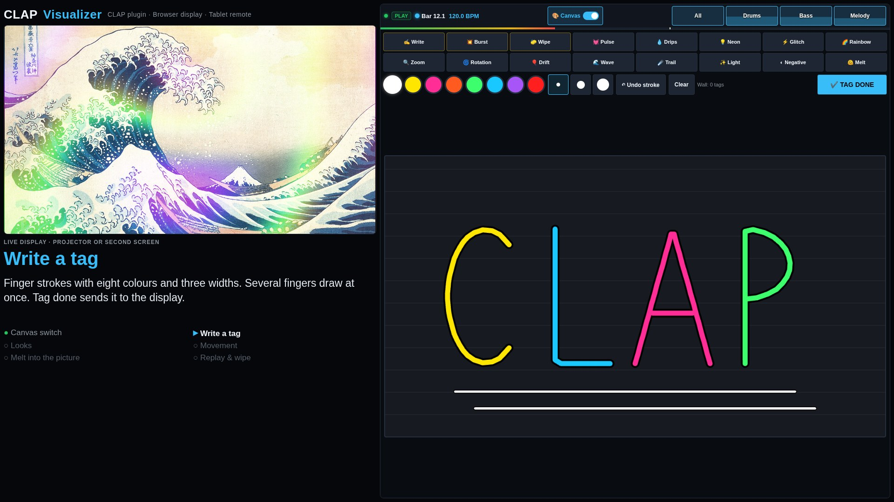
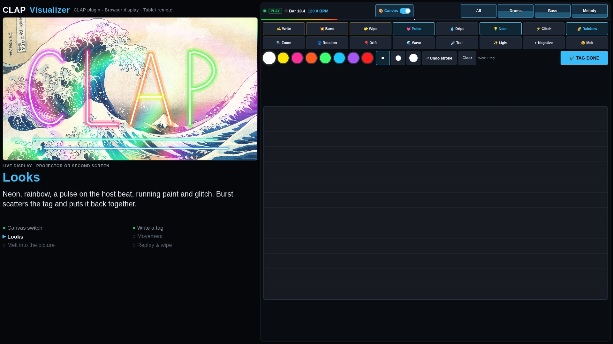
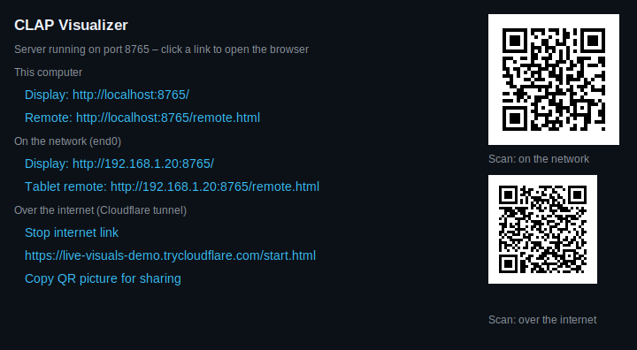
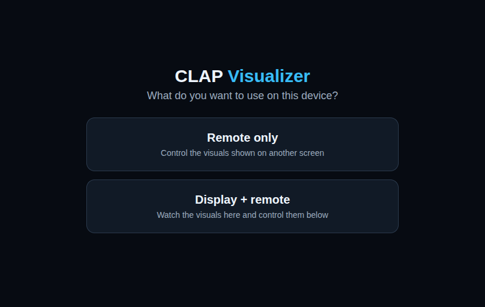
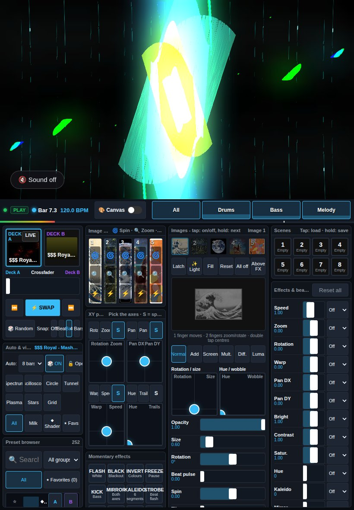
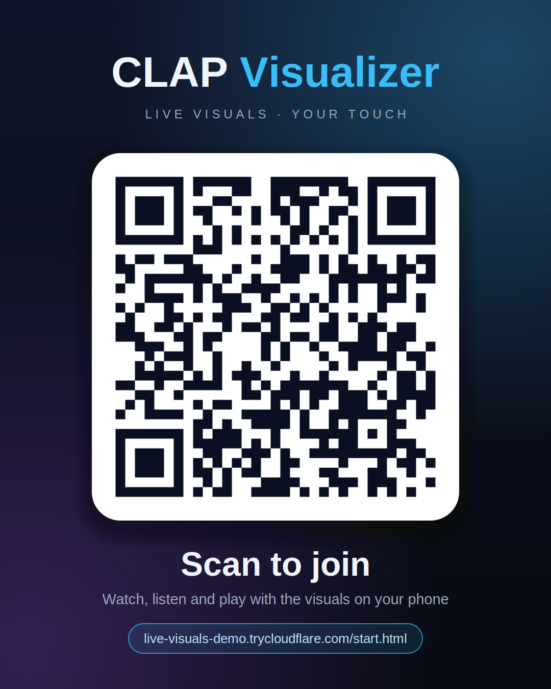

<div align="center">

# CLAP Visualizer

**Your DAW makes the music. Your browser makes the show. Your iPad takes control.**

[](LICENSE)


An audio-reactive VJ playground for REAPER: a lightweight native CLAP effect streams audio and transport to a browser, with a touch controller on your tablet. Built on Linux ARM64 with Omarchy, C++, WebGL2 and Butterchurn.

[**Watch the demo ↗**](https://github.com/goarstne/clap-visualizer/releases/download/v1.1.0/clap-visualizer-demo.mp4) · [**Graffiti tags demo ↗**](https://github.com/goarstne/clap-visualizer/releases/download/v1.1.0/clap-visualizer-tags-demo.mp4) · [**Download & releases**](https://github.com/goarstne/clap-visualizer/releases) · [**Control protocol**](docs/CONTROL.md)


</div>

## What you can do

- **Mix two visual decks:** A/B crossfader, timed transitions, automatic switching and beat/bar quantization driven by host transport.
- **Explore MilkDrop and shaders:** bundled Butterchurn presets plus seven visual types: spectrum, oscilloscope, circle, tunnel, plasma, stars and grid, all modulated by Clubber-style 4D vectors (`[energy, envelope, trigger, pitch]`). Search presets, filter groups and save favorites.
- **Perform with touch:** four assignable XY pads, spring return, effect faders and 16 momentary effects, including blackout, invert, kaleidoscope, RGB split, freeze and strobe.
- **Play it like an instrument:** the **🎛 Perform** switch turns the controller into 96 pads (12 × 8 on a landscape tablet), coloured by function: presets from your favourites, the built-in shader visuals, effects that last as long as you hold them, kaleidoscope shapes, images with their blend modes and shots, camera and all graffiti tag looks. Hold **LOCK** and tap an effect to keep it on, press longer for a tooltip. Nothing switches by itself in this mode. Eight hard effects live only here: glitch, stutter, tunnel, neon edges, pixel, vortex, thermal and shockwave.
- **Paint with images:** five image layers with drag, pinch, rotation, opacity, six blend modes, tiling, hue, wobble and bass pulse. Trigger zoom, spin and flash shots; draw light with up to three fingers.
- **Bring a camera in:** **📷 Cam** on the controller puts the live camera of that phone or tablet into an image slot, where it takes blend modes, tiling, hue and all effects like any picture. A webcam on the display computer works too.
- **Tag the wall:** a switch turns the controller into a 16:9 canvas. Draw graffiti tags with your finger; a finished tag is mixed into the visuals and runs through mirror, kaleidoscope, colour and trails. Sixteen buttons replay, burst and wipe the tags, restyle them (pulse, drip, neon, glitch, rainbow), move them in time with the host (zoom, rotation, drift, wave, trail) or melt them into the picture (light, negative, melt).
- **Shape the response:** Kick, Bass, Lead and Hats selectors with live level meters, beat trigger indicators and detected pitch note badges. Driven by Clubber-style musical frequency and transient analysis (not AI stem separation).
- **Recall a look:** eight scene slots, beat-linked effects and visual state saved with the REAPER project. Favorites and pad assignments stay in the browser.
- **Keep audio intact:** stereo float/double passthrough; visualization and networking run outside the audio callback.
- **Bring your friends in:** scan a QR code in the plugin window to join from a phone, or start a Cloudflare tunnel with one click and share the link as a ready-made picture. Guests can watch, hear the master bus and play along.
- **Run locally:** plugin-served display and controller over HTTP/WebSocket, with bundled browser libraries and no cloud account.

## Graffiti tags

Flip the **Canvas** switch on the controller and the dashboard becomes a wall in the 16:9 shape of the display. Draw with one or several fingers, pick from eight colours and three widths, undo a stroke or clear the wall. **Tag done** sends the tag to the display, where it is mixed into the picture before colour, RGB split and trails and follows mirror and kaleidoscope, so it runs through the effects instead of sitting on top. Up to six tags stay on the wall.



Sixteen buttons above the wall shape what the tags do:

| Group | Buttons |
|---|---|
| One-shots, optionally on the next beat or bar | **Write** replays the strokes, **Burst** scatters and reassembles them, **Wipe** clears the wall |
| Looks | **Pulse** on the host beat, **Drips** of running paint, **Neon**, **Glitch**, **Rainbow** |
| Movement in the tempo of the host | **Zoom**, **Rotation**, **Drift**, **Wave**, and **Trail** for a fading tail |
| Melting into the picture | **Light** adds the tag, **Negative** inverts what lies beneath, **Melt** bends and tints the visuals |



The looks and movements combine freely and are saved with the REAPER project; the tags themselves are not stored. [Watch the 90-second graffiti demo ↗](https://github.com/goarstne/clap-visualizer/releases/download/v1.1.0/clap-visualizer-tags-demo.mp4)

## Setup: Linux ARM64, REAPER and Omarchy

The native plugin is Linux-only and uses an X11/XCB window. On an Omarchy Wayland desktop, REAPER's plugin window needs XWayland. Build on the same architecture as your REAPER installation; an ARM64 `.clap` cannot load in an x86_64 host.

1. Install build dependencies on your Arch/Omarchy system:

   ```bash
   sudo pacman -S --needed base-devel git pkgconf cairo libxcb qrencode
   ```

2. Install [REAPER for Linux](https://www.reaper.fm/download.php). For ARM64 choose **Linux aarch64**, extract the archive and run its supplied `install-reaper.sh`. The development machine uses native aarch64 REAPER 7.79. No Windows bridge is needed.

3. Clone, build and install:

   ```bash
   git clone https://github.com/goarstne/clap-visualizer.git
   cd clap-visualizer
   make -j"$(nproc)"
   make install
   ```

   This installs `~/.clap/clapvisualizer.clap` and its adjacent `clapvisualizer.web/` assets. Override the destination with `make install CLAP_DIR=/your/clap/path`. Keep the web directory beside the plugin.

4. In REAPER, rescan the CLAP path in **Preferences → Plug-ins → CLAP** if needed, then add **CLAP Visualizer** to the master FX chain (or a stereo track). Use one instance per port. Play your project so REAPER processes the effect and supplies its transport.

5. Click the **Display** link in the plugin window, or open `http://localhost:8765/` in a WebGL2-capable browser on your computer. Use fullscreen on a second monitor or projector. On the iPad, join the same LAN and open `http://YOUR-COMPUTER-IP:8765/remote.html` in Safari. The plugin window lists LAN addresses. Landscape is the main performance layout; portrait uses two columns.

The iPad controls the browser display; it does not load the native plugin. The mockup above shows the actual interface in an iPad-sized Chromium viewport inside an illustrated tablet frame.

### Your own pictures

Personal images are **excluded from Git**: `Pictues/` (the original local folder), `Pictures/`, `pictures/` and generated `web/pictures/` are ignored. Add JPG, JPEG, PNG or WebP files to a folder of your choice, then run:

```bash
make install PICTURES=/absolute/path/to/your/images
```

Only the first five image slots are shown at a time; each can select a file from the imported list. `make pictures` rebuilds the generated web image folder. It does not delete the source images. Demo images are separate public-domain works with [source credits](demo/CREDITS.md).

### Live camera

Select an image slot on the controller and tap **📷 Cam**: the slot now shows the camera of that device, **Flip** switches between back and front camera. Hold the slot to go back to a picture. One camera is shown at a time; every open display gets it.

- **Phones and tablets need the internet link.** Browsers only hand out the camera on `https`, so open the controller through the `https://….trycloudflare.com` address (see below), not through `http://YOUR-COMPUTER-IP:8765`. The video itself still travels directly between the devices over WebRTC; expect a delay of a fraction of a second.
- **A webcam on the display computer** is used when a slot is set to the camera and no phone is sending. The browser asks for permission once on `http://localhost:8765`.
- **Cam depth cut** keeps what is close to the camera and makes the background transparent, so the visuals run behind you. Raise the fader until only the foreground is left. The display computer estimates the depth of the camera picture with [Depth Anything V2 Small](https://github.com/DepthAnything/Depth-Anything-V2) on its CPU, a few times per second, and only while the fader is up. Run `make depth` once before `make install`: it downloads the model and onnxruntime-web (41 MB) into `web/vendor/depth/`. Without them the fader does nothing.
- Guests outside your network connect through a public STUN server (`stun.l.google.com`); some mobile networks block that and show no picture.

### Networking and compatibility

The server binds to **all interfaces on port 8765**, without login or TLS. Use a trusted LAN: connected clients can receive audio, control visuals and read the served web assets, including imported images. Do not forward the port to the internet; use the internet link below instead. If a firewall is active, allow TCP 8765 from your tablet's LAN only.

### Phones, QR codes and the internet link



The plugin window lists the addresses as links and shows a QR code for the first network address. It opens the start page, which asks whether the device should be the **remote only** or **display + remote** on one page:

| Start page | Display + remote |
|---|---|
|  |  |

**Sound:** the display has a switch in the bottom left corner (on a big screen it appears on touch or pointer movement). Tap it to hear the master bus on that device. The stream is 16-bit stereo, about 1.5 Mbit/s per listener, and plays roughly a quarter of a second late.

**Start internet link** runs a [Cloudflare quick tunnel](https://developers.cloudflare.com/cloudflare-one/connections/connect-networks/do-more-with-tunnels/trycloudflare/) and shows its `https://….trycloudflare.com` address as a link and a second QR code. It needs `cloudflared` (`sudo pacman -S cloudflared`), no account and no open port. The link is off until you start it, gets a new random address every time and stops with the plugin.



**Copy QR picture for sharing** puts this picture on the clipboard (via `wl-copy` or `xclip`), ready to paste into a chat. The addresses in these screenshots are examples.

There is still no login: everyone who has the address can watch, listen, control and load the imported images, so share it like a password. The plugin only accepts WebSocket connections from its own pages, so other websites open in your browser cannot listen in.

<br clear="right">

Set environment variables **before starting REAPER**:

```bash
VSTVIS_PORT=8766 reaper
# Development override instead of installed assets:
VSTVIS_WEB_DIR="$PWD/web" VSTVIS_PORT=8766 reaper
```

The `VSTVIS_*` settings, plugin identifier `org.vstvisualizer.visualizer` and browser storage keys retain their original names for compatibility. This project implements CLAP, with no VST build. Existing users should replace the old `vstvisualizer.clap` installation and its web folder after backing up; do not keep both plugin copies enabled.

If the display is blank, check WebGL2 support and browser console errors. For a disconnected remote, check the LAN IP, port, firewall and that the effect is processing. A port collision leaves audio passthrough running but prevents that instance from serving the UI.

## Development and checks

The CLAP headers are vendored at the revision recorded in [`third_party/clap/REVISION`](third_party/clap/REVISION). No SDK download or JavaScript package installation is needed for the plugin.

```bash
# Tests also need Python 3, Node.js and a working X11/XWayland DISPLAY:
make test
# Run the actual plugin in the included test host, without REAPER:
VSTVIS_WEB_DIR="$PWD/web" tools/fakehost 0 build/clapvisualizer.clap
```

`make test` covers native audio passthrough, state persistence, HTTP path handling, WebSocket framing and relay, browser-side analysis/state logic, and the clickable native window. [`tools/touchtest.js`](tools/touchtest.js) additionally exercises touch controls in landscape and portrait Chromium emulation, and [`tools/camtest.js`](tools/camtest.js) sends Chromium's fake camera from a remote to three displays; both need a local Playwright installation. Real iPad Safari and other host/OS combinations are not certified by those tests. [`tools/depthtest.js`](tools/depthtest.js) checks the depth cut of the camera layer the same way. [`tools/perftest.js`](tools/perftest.js) plays the performance pads in an iPad 12.9" emulation.

The [demos](https://github.com/goarstne/clap-visualizer/releases/tag/v1.1.0) use the real plugin in the test host, an original synthesized track, touch automation and public-domain images. They demonstrate the browser workflow rather than a screen recording of REAPER. See [demo recording instructions](docs/DEMO.md).

## License

Project code is [MIT licensed](LICENSE). Bundled CLAP headers and Butterchurn libraries retain their accompanying licenses. Demo artwork attribution and public-domain information are listed in [media credits](demo/CREDITS.md).
